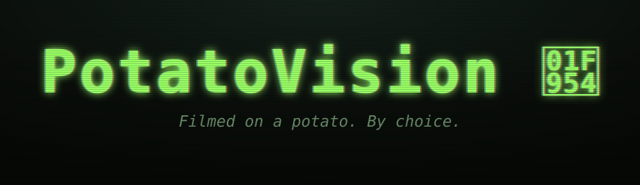
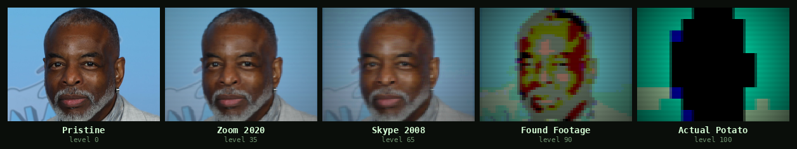

# PotatoVision

[](https://github.com/gkoch02/potatovision/actions/workflows/github-code-scanning/codeql)
[](LICENSE)

A single-page web app that turns your webcam feed into the worst possible
video on demand. Drag the **Potato Level** slider from 0 to 100 and watch
yourself disintegrate into pixelated, color-quantized, chromatically-bleeding,
scanlined, sickly-green found-footage glory. Filmed on a potato, by choice.



<p align="center">
  
  <br/>
  <sub><i>The five presets, applied to the same photo.<br/>
  Source photo: "LeVar Burton Photo Op GalaxyCon Raleigh 2023" by
  <a href="https://commons.wikimedia.org/w/index.php?curid=135352231">Super Festivals</a>,
  <a href="https://creativecommons.org/licenses/by/2.0/">CC BY 2.0</a>.</i></sub>
</p>

## Run it

It is a static page, so either open the file or serve the folder:

```bash
# Option A — open the file directly
open index.html        # macOS
xdg-open index.html    # Linux

# Option B — serve it (recommended; some browsers prefer http for getUserMedia)
python3 -m http.server 8000
# then visit http://localhost:8000
```

Click **Start camera**, accept the permission prompt, and start ruining your
own face. It works in Chromium, Chrome, Edge and Firefox; Safari needs HTTPS
or `localhost` for `getUserMedia`.

## What it does

The one slider drives a degradation pipeline: a resolution drop (down to
28×21 pixels), per-channel color quantization (8 bits down to 1), chromatic
ghosting, CRT scanlines, a radial vignette, a sickly-green cast at maximum
potato, and frame stutter, where at high levels frames spontaneously hold to
fake bandwidth starvation. Five presets (*Pristine*, *Zoom 2020*, *Skype
2008*, *Found Footage*, *Actual Potato*) set the slider for you.

**Snap** downloads the current frame as `potatovision-<timestamp>.png`,
re-encoded through a punishing JPEG pass, with a red `● REC` and a date stamp
for that early-2000s camcorder look. **Emoji Mode** replaces the canvas with a
live, animated 🥔/🍟/🟧/🟫/⬛ grid.

## Use it as your Zoom camera

PotatoVision is a web page, so it can't pretend to be a system webcam by
itself — Zoom, Meet, and Teams pick from OS-level camera devices. The
shortest path to "my video call now looks like a potato" is **[OBS
Studio](https://obsproject.com)**, which is free and exists on macOS,
Windows, and Linux:

1. Run PotatoVision locally: `python3 -m http.server 8000`.
2. In OBS, add a **Browser Source** pointing at `http://localhost:8000`
   (1280×720 is a good size). Click **Start camera** inside the source's
   interaction window once, so the page has camera permission.
3. Drag the **Potato Level** slider to taste. The OBS preview updates live.
4. Click **Start Virtual Camera** in OBS.
5. In Zoom (or Meet, Teams, Discord, etc.), pick **OBS Virtual Camera** as
   your camera.

PotatoVision and OBS both stay local — the page renders in your browser and
OBS reads that canvas off your machine to expose a virtual camera device.
Once you select **OBS Virtual Camera** inside Zoom/Meet/Teams, though, the
conferencing app transmits that video to the call like any other webcam feed.
The privacy note below covers PotatoVision itself, not whatever app you point
at the virtual camera.

## Privacy

Every frame stays in your browser; there is nothing for it to be sent to.
Closing the tab pauses the camera, and so does switching to another tab,
which `tests.html` asserts. The code is plain JS in `potatovision.js`.

## Tests

There's no test runner — open `tests.html` in a browser the same way you run
the app. It imports `potatovision.js` against stub DOM elements and runs an
assertion harness covering the per-stage effect math, the `index.html` DOM
contract, the snapshot path, and the camera-paused-when-tab-hidden privacy
promise. Pass/fail counts at the top.

## Files

`index.html` is the markup, `styles.css` the retro-CRT theme,
`potatovision.js` all of the runtime logic and `tests.html` the in-browser
assertion harness. `title.svg` and `preview-strip.png` (all five presets, through
the real filter) are the README's images, and `CLAUDE.md` is the contributor
and agent guide. There is no build step, package manifest or framework.

## License

MIT — see [LICENSE](LICENSE). The preview strip's source photograph is CC BY
2.0, credited above.
